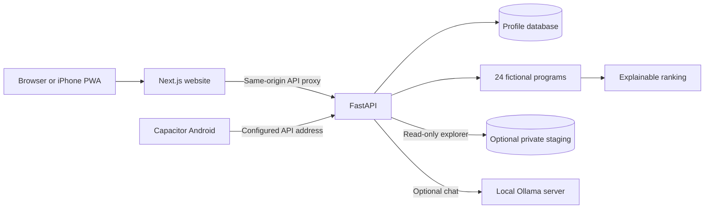

# LifePilot AI

An explainable study-abroad planning workspace built with Next.js and FastAPI. Create a student profile, explore programs, compare costs, adjust decision priorities, and discuss tradeoffs with an optional local AI assistant.

**Recommendations currently use 24 explicitly fictional programs.** TOPSIS scores express relative decision fit; they are not admission probabilities or guarantees of eligibility.

## Main features

- **Student profiles:** validated inputs, local database persistence, and browser restoration through a profile-ID pointer.
- **Demo Recommendations:** deterministic TOPSIS ranking with adjustable affordability, academic alignment, career and student-experience priorities.
- **Program comparison:** searchable demonstration catalog, details dialogs, side-by-side comparison, and budget charts.
- **Real Programs explorer:** a separate read-only view of optional staging data, with country, university, field and keyword filters; missing-information and review labels; published fee text; dated deadline status; and official links.
- **Local AI assistant:** optional Ollama chat with structured failure/retry handling. The assistant currently receives demonstration context; verified RAG is a future feature.
- **Mobile support:** responsive light/dark interfaces, an installable iPhone PWA, offline fallback, and a Capacitor Android project.

## Technology stack

| Layer | Technologies |
| --- | --- |
| Frontend | Next.js 16 App Router, React 19, TypeScript, Tailwind CSS 4 |
| Interface | Framer Motion, Lucide icons, Recharts |
| Backend | FastAPI, Pydantic, SQLAlchemy, HTTPX |
| Storage | SQLite locally; PostgreSQL through Docker Compose |
| Ranking | A deterministic, vector-normalized TOPSIS implementation |
| AI | Optional Ollama with a locally managed Llama model |
| Mobile | Web app manifest/service worker and Capacitor 8 for Android |
| Quality | pytest, Ruff, ESLint, TypeScript and Playwright |

## Architecture



The real explorer and demonstration ranking use separate contracts and repositories. Real staging records are not passed into TOPSIS. The API does not automatically import research exports, and a fresh installation displays an honest empty Real Programs state until the operator supplies authorized staging data.

```text
backend/app/        API routes, schemas, repositories and services
backend/tests/      Ranking, API, collection and privacy tests
frontend/src/       Website pages, components and typed API client
frontend/public/    PWA manifest, service worker, icons and offline fallback
frontend/tests/     Website, PWA and Android-export browser journeys
android/            Capacitor native source and Gradle wrapper
scripts/            Development, build and isolated-test helpers
data/sample/       Public, explicitly fictional demonstration catalog
data/raw/          Local-only university response snapshots
data/processed/    Local-only research exports and derived artifacts
data/sources/      Local-only reviewed collection registry
docs/               Architecture and setup guides
```

## Installation

Requirements: **Node.js 22+** (Node 24 is used locally), **Python 3.11+** (tested with Python 3.12), and Git. Ollama and Android Studio are optional.

Clone or download this repository, open PowerShell in `LifePilot-AI`, and run:

```powershell
if (-not (Test-Path .env)) { Copy-Item .env.example .env }
python -m venv .venv
.\.venv\Scripts\python.exe -m pip install -r backend/requirements-dev.txt
npm.cmd ci
npm.cmd --prefix frontend ci
```

The root Node dependencies provide Capacitor tooling; the website's dependencies are in `frontend/`. Set your own database password before using PostgreSQL. The example environment file contains placeholders only; keep the resulting `.env` private.

On macOS/Linux, use `python3 -m venv .venv`, `.venv/bin/python`, and `npm` in place of the Windows executable names.

## Run locally

Start both development servers from the project root:

```powershell
.\.venv\Scripts\python.exe scripts/dev.py
```

Open [LifePilot AI](http://localhost:3000) and [FastAPI documentation](http://localhost:8000/docs). The launcher uses loopback addresses and stops its own servers with Ctrl+C.

For separate terminals, start the backend:

```powershell
.\.venv\Scripts\python.exe -m uvicorn app.main:app --app-dir backend --host 127.0.0.1 --port 8000 --reload
```

Start the frontend in another terminal:

```powershell
npm.cmd --prefix frontend run dev
```

Try a sample profile, inspect **Why this fit**, adjust ranking priorities, and compare two or three demonstration programs. The API, profile storage, explorer and recommendations work without Ollama.

For a production website build:

```powershell
npm.cmd --prefix frontend run build
npm.cmd --prefix frontend run start
```

Website API calls use relative `/api/*` URLs. `BACKEND_URL` in `frontend/.env.local` changes the server-side proxy target; rebuild after changing it for production. The default local target is `http://127.0.0.1:8000`.

## Optional AI assistant

Install and start Ollama separately, then pull the configured model:

```powershell
ollama pull llama3.2:latest
ollama list
# Run this only if the Ollama application is not already serving:
ollama serve
```

Root `.env` supports `OLLAMA_BASE_URL`, `OLLAMA_MODEL`, and `OLLAMA_TIMEOUT_SECONDS`. Restart FastAPI after changes. Profile context and conversation messages go to your configured Ollama server; conversations remain in page memory. The assistant does not browse official websites or retrieve the private research corpus.

## iPhone PWA

The website includes a manifest, Apple touch icon, standalone metadata, safe-area support, and a service worker. The worker caches only seven generic public resources and provides an offline fallback; API responses, profiles, rankings and chat are not cached or queued for offline submission.

Use a trusted HTTPS origin to test installation on an iPhone. Local HTTP LAN access can test layout and connectivity but does not validate service-worker support. Safari installation uses **Share > Add to Home Screen**, with **Open as Web App** enabled when offered.

For local HTTPS, create and trust a development certificate as described in the [Windows and iPhone PWA guide](docs/IOS_PWA.md), keep FastAPI and the production Next.js server running, then run:

```powershell
npm.cmd --prefix frontend run pwa:https
```

The helper forwards local HTTPS on port 3443 to Next.js on port 3000. Certificate files stay private. Also see the [real-program explorer guide](docs/REAL_PROGRAM_EXPLORER.md).

## Android

Capacitor is configured at the project root with app ID `com.lifepilot.ai` and web assets in `frontend/out`.

```powershell
npm.cmd run android:sync
npm.cmd run android:open
```

The default development API address is the Android Studio emulator host alias. Physical devices need a reachable backend address supplied through `NEXT_PUBLIC_API_BASE_URL`; signed release exports require an explicit HTTPS URL. Android exports disable the website service worker and omit Next.js proxy rewrites.

Native compilation requires Android Studio, SDK 36 and JDK 21. See the [Android and APK guide](docs/ANDROID.md). Generated native web assets, SDK paths, APKs, certificates and signing keys are not committed.

## Docker Compose

With Docker running and an existing `.env` containing your chosen PostgreSQL password:

```powershell
docker compose up --build
# Stop containers while preserving the database volume:
docker compose down
```

Compose runs PostgreSQL, FastAPI and the standalone Next.js website. Ollama remains a separately managed host service. Local app ports are bound to loopback; the existing Compose configuration is intended for development, not a public multi-user deployment.

## Tests and checks

```powershell
# From backend/
..\.venv\Scripts\python.exe -B -m pytest -q -p no:cacheprovider
..\.venv\Scripts\python.exe -B -m ruff check --no-cache app tests
..\.venv\Scripts\python.exe -B -m ruff format --check --no-cache app tests

# From the project root
npm.cmd --prefix frontend run build
npm.cmd --prefix frontend run lint
npm.cmd --prefix frontend run typecheck
# Stop other servers on ports 3000/8000 before browser tests:
$env:CI = '1'
npm.cmd --prefix frontend run test:e2e
Remove-Item Env:CI
```

Backend tests use isolated databases and mocked Ollama HTTP responses. Browser tests start their own API/website processes and use ignored test databases. Windows uses installed Edge; other platforms need Playwright Chromium (`npx playwright install chromium` from `frontend/`). Mobile viewports are emulated and do not replace real iPhone Safari testing.

The public repository intentionally excludes the private university export. Tests tied specifically to that export report explicit skips when it is absent; independent API, ranking, mocked collection, PWA, nullable-field and error-state checks remain available. With the authorized export present locally, the full real-catalog integration cases run normally. See [data handling](data/README.md) and [verification notes](docs/verification.md).

`npm.cmd run android:test` builds and checks the static Android export without synchronizing the native project. Rebuild the normal website afterward. Do not run website and Android builds concurrently because they share Next.js intermediate output.

## API overview

| Endpoint | Purpose |
| --- | --- |
| `GET /api/health` | Database/API readiness |
| `POST /api/profile` | Store a validated profile snapshot |
| `GET /api/profile/{id}` | Restore a profile |
| `GET /api/universities` | Fictional demonstration catalog |
| `GET /api/real-programs` | Read-only optional staging catalog and filters |
| `POST /api/recommendations` | Demo-only TOPSIS ranking and explanations |
| `POST /api/chat` | Optional Ollama conversation |

## Data and publication scope

The public dataset is `data/sample/universities.json`, whose institutions, programs, costs and indices are explicitly fictional.

An existing local research workspace contains 78 unreviewed real-program records across seven countries. Those exports, source snapshots, RAG preparation text, quality reports, collection registry and local databases are **not distributed in this repository**. The source registry records local-research restrictions; no public redistribution permission is asserted. Do not remove those ignore rules merely to populate the explorer. See [data handling](data/README.md).

Environment files, TLS/signing keys, databases, test traces/screenshots, dependency folders, build output, local audit notes and the independent `MyMobileApp/` Expo experiment remain private. [Publication review](docs/PUBLICATION_REVIEW.md) explains the commit boundary.

## Current limitations

- Recommendations use synthetic indices and illustrative academic alignment, not validated admissions predictions.
- Real-program review and recommendation eligibility remain separate; unreviewed real data is never ranked.
- Live Llama inference, native APK compilation and real-device Safari behavior require their own environment checks. Historical results and limits are recorded in `docs/verification.md`.
- There is no authentication, per-user ownership, profile deletion API, migration framework or rate limiting. A profile UUID is an identifier, not an access control.
- Editing creates a new profile snapshot. **Forget profile** removes the browser pointer, not database records.
- Verified RAG, embeddings, a vector index, admissions prediction and background application submissions are not implemented.

## Roadmap

1. Review and normalize authorized real-program evidence without inventing missing costs or deadlines.
2. Add saved shortlists and application/deadline tracking.
3. Introduce evidence-backed real-program ranking criteria and explicit readiness rules.
4. Add source-cited retrieval for the assistant.
5. Implement identity, ownership, migrations and operational controls before shared hosting.
6. Extend real-device and native build validation.

## License

A project license has not been selected. No license is implied for the private university research artifacts. Third-party dependencies retain their respective licenses.
